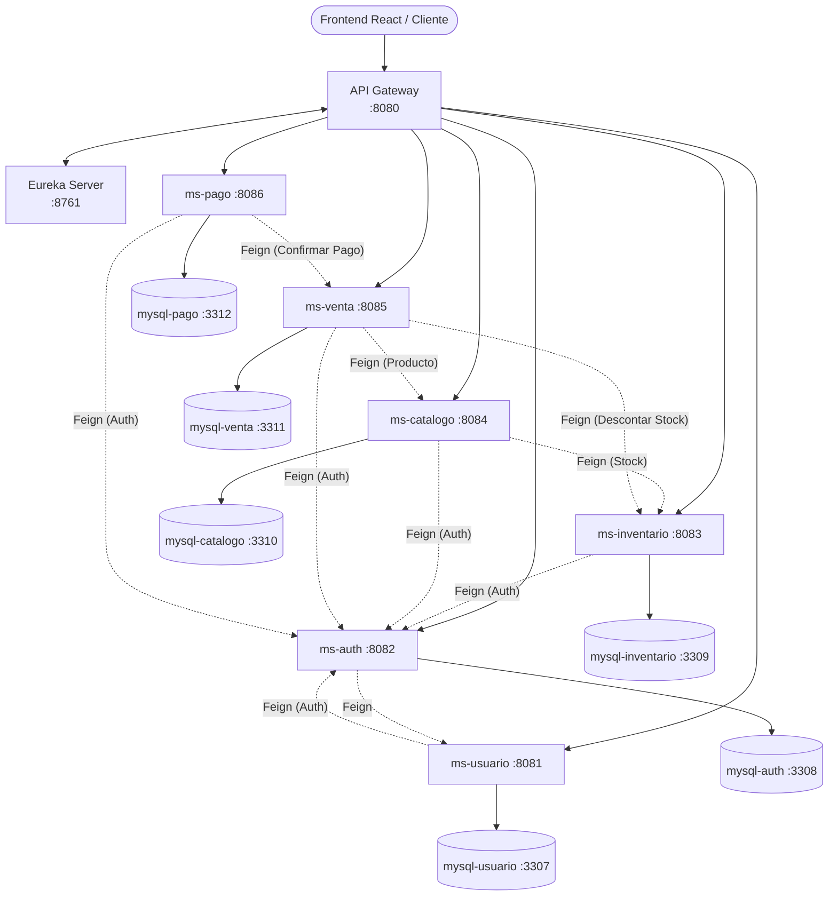

# El Volcán — Backend de Microservicios

Sistema de gestión de venta y distribución de gas licuado y accesorios **El Volcán**, construido con una **arquitectura de microservicios** sobre el ecosistema **Spring Boot 3.4.0** y **Spring Cloud 2024.0.0**, con **API Gateway**, **Eureka Server**, **OpenFeign**, **MapStruct**, **Swagger / OpenAPI**, **Flyway**, **MySQL 8.0** y **Docker Compose**.

---

## 1. Arquitectura y Responsabilidades de los Microservicios

| Servicio | Puerto | Base de Datos MySQL | Responsabilidad Principal |
|---|---|---|---|
| `eureka-server` | `8761` | — | Servidor de descubrimiento y registro de microservicios (Netflix Eureka). |
| `gateway-service` | `8080` | — | Puerta de enlace única (API Gateway) que enruta `/api/v1/**` hacia cada microservicio. |
| `ms-usuario` | `8081` | `mysql-usuario` (`3307`) | Gestión de usuarios (`ADMIN`, `OPERADOR`, `REPARTIDOR`, `CLIENTE`) y validación de credenciales. |
| `ms-auth` | `8082` | `mysql-auth` (`3308`) | Autenticación centralizada (`login`, `registro`, `logout`) y validación de tokens/sesiones para **todos los microservicios**. |
| `ms-inventario` | `8083` | `mysql-inventario` (`3309`) | Control del stock actual/mínimo de productos y registro de movimientos (`ENTRADA`, `SALIDA`, `AJUSTE`, `SOLICITUD_REPOSICION`). |
| `ms-catalogo` | `8084` | `mysql-catalogo` (`3310`) | Catálogo de productos e imágenes `.webp` para el frontend, obteniendo el stock en tiempo real desde `ms-inventario` vía OpenFeign. |
| `ms-venta` | `8085` | `mysql-venta` (`3311`) | Generación de ventas/pedidos de clientes, descuento de stock en `ms-inventario` y asignación de repartidores. |
| `ms-pago` | `8086` | `mysql-pago` (`3312`) | Procesamiento, validación y reembolso de pagos asociados a las ventas, notificando a `ms-venta` vía OpenFeign. |

---

## 2. Diagrama de Arquitectura



---

## 3. Cómo levantar el proyecto con Docker Compose

```bash
cd backend
docker compose up --build -d
```

### URLs disponibles al iniciar:
- **Eureka Dashboard**: `http://localhost:8761`
- **API Gateway**: `http://localhost:8080`
- **Swagger `ms-usuario`**: `http://localhost:8081/doc/swagger-ui.html`
- **Swagger `ms-auth`**: `http://localhost:8082/doc/swagger-ui.html`
- **Swagger `ms-inventario`**: `http://localhost:8083/doc/swagger-ui.html`
- **Swagger `ms-catalogo`**: `http://localhost:8084/doc/swagger-ui.html`
- **Swagger `ms-venta`**: `http://localhost:8085/doc/swagger-ui.html`
- **Swagger `ms-pago`**: `http://localhost:8086/doc/swagger-ui.html`
